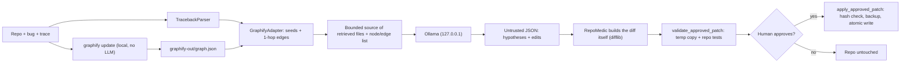

# RepoMedic AI

Local-first, graph-assisted repository debugging with small local models.

**The problem.** Debugging assistants usually send a whole repository (or a guess at the right files) to a cloud
model and then ask you to trust a patch. RepoMedic explores a different design: keep everything on your machine,
use a real code knowledge graph to pick *which* code the model sees, treat the model's output as untrusted, prove
a patch in an isolated copy with your own tests, and change your repository only after you explicitly approve.

**How it works.** Point it at a repository and a bug report. The official
**[Graphify](https://github.com/Graphify-Labs/graphify)** CLI builds a code graph (tree-sitter, no LLM).
RepoMedic retrieves the related functions, files and call relationships, a **local Ollama model** proposes a
diagnosis and an edit, RepoMedic turns the edit into a diff itself, **validates it in a temporary copy** with the
repository's tests, and applies it **only after you approve**.

> **Status: a working research prototype.** The full workflow runs end to end on Windows, but the 1B–3B local models
> it was tested with are unreliable: in the 72-trial benchmark only `qwen2.5:3b` ever produced a patch that passed
> all tests (7/72 trials overall; `gemma3:1b` 0/36). **Graph retrieval did not improve patch success.** A 2-hop
> variant improved which files were retrieved (bug file found in 5/6 cases instead of 2/6) but not end-to-end success.
> The Streamlit UI was tested with Streamlit's headless test runner and a real server start-up, but **has not been
> looked at in a real browser**. See [Benchmark](#benchmark), [Limitations](#limitations) and
> [PROJECT_AUDIT.md](PROJECT_AUDIT.md).

## Requirements
- Windows 10/11 with PowerShell (developed and verified on Windows 11; other platforms are untested).
- Python 3.13 (verified; 3.10+ is Graphify's stated minimum).
- [Ollama](https://ollama.com) running locally with at least one model (`qwen2.5:3b` verified).
- The official `graphifyy` package (pinned to 0.9.93), installed into its own virtual environment.
- No cloud API keys are used or needed.

## Repository layout
| Path | Purpose |
|---|---|
| `repomedic.py` | Core: retrieval strategies, Graphify adapter, Ollama client, diff construction, validation, approved apply, CLI |
| `app.py`, `run_ui.ps1`, `.streamlit/` | Streamlit frontend and its Windows launcher / localhost-only config |
| `tests/` | Test suite (unit, adversarial patch tests, UI tests, real-Graphify and real-Ollama integration tests) |
| `benchmarks/` | Benchmark cases, runner, analysis scripts, and the recorded results (`results/` is evidence; do not edit) |
| `demo/` | Artifacts from the first real end-to-end run; two files double as test fixtures |
| `PROJECT_AUDIT.md` | Audit of what is verified, what is mocked, and what is missing |

## Quick start (Windows / PowerShell)

```powershell
# 0. Get the code
git clone https://github.com/shrey04kaitke-sys/RepoMedicAI.git
cd RepoMedicAI

# 1. Graphify in an isolated environment (pinned; verified 0.9.93)
python -m venv .venv-graphify
.\.venv-graphify\Scripts\python.exe -m pip install -r requirements-graphify.txt
#    If pypi.org is unreachable, add: --index-url <a mirror you trust>
#    (this project's verified install used pypi.tuna.tsinghua.edu.cn, a third-party mirror)

# 2. App dependencies (core CLI needs only the standard library)
python -m pip install -r requirements.txt

# 3. Local model
ollama pull qwen2.5:3b          # verified; gemma3:1b also tested (see results)

# 4a. Frontend -> open http://localhost:8501  (listens on localhost only)
.\run_ui.ps1                  # starts the server and opens your browser; add -NoBrowser to skip that
#     or, without the script:  python -m streamlit run app.py --server.address localhost
# 4b. or CLI
python repomedic.py C:\path\to\repo --bug "what is wrong" --failure "<traceback or pytest output>" --validate
```

RepoMedic finds `graphify` via `$GRAPHIFY_EXECUTABLE`, then `PATH`, then `.venv-graphify`.

### Graph generation and regeneration
```powershell
.\.venv-graphify\Scripts\graphify.exe update .     # tree-sitter AST, no LLM, writes graphify-out/
python repomedic.py . --graph-only --refresh-graph # same, via RepoMedic, then prints graph facts
```
Regenerate after code changes. RepoMedic warns when source files are newer than `graph.json` and,
in graph mode, rebuilds automatically if it can. `graphify-out/graph.html` is Graphify's own
visualisation; it loads `vis-network` from **unpkg.com**, so the page needs internet in your browser
(no repo data is uploaded).

## The frontend (`app.py`, Streamlit)
URL: **http://localhost:8501**. Launch from the project folder with `.\run_ui.ps1` (see Quick start).

1. **Repository:** a path box with a green "Active repository" banner, or *Sidebar → Sample project* to create a
   small buggy project (the benchmark cases) under `demo_workspace/` and select it. Only folders RepoMedic
   created itself (marked `.repomedic-sample`) are ever reset.
2. **Bug report:** description plus optional traceback, or "Run the repo's tests" to capture a real failure
   (fixed command, isolated copy, no secrets, no shell). Text typed here is never executed.
3. **Graph:** nodes / edges / communities / relation counts read from the real `graph.json`, build time,
   staleness warning, *Generate / refresh graph*, **Open graph.html in my browser**, download, and an embedded
   preview. `graph.html` is only opened or served if it lives inside `<repo>/graphify-out`.
4. **Strategy selector** (sidebar): `graph` (1 hop), `graph2` (2 hops, experimental), and the `keyword` / `all` baselines.
5. **Results:** diagnosis with evidence, token and latency metrics, and a **Retrieved context** panel with three
   tabs — files sent to the model, functions/nodes (file, line, hop distance), and graph relationships
   (`source --relation--> target`, confidence). A fallback from graph to keyword retrieval is shown as a warning.
6. **Patch:** readable diff → **Validate** (isolated copy; test results before and after) → **Approve and apply**
   or **Reject**. Approval needs a validated patch and a ticked review box; nothing is applied automatically.
7. **Errors shown:** Ollama unreachable, model not installed (with `ollama pull`), Graphify missing, no graph,
   graph build failure, rejected/invalid patch, failed or timed-out tests, unusable model output.

## Architecture and data flow

Retrieval strategies (`--strategy`): `graph` (default; 1-hop; falls back to keyword *and says so* if there
is no usable graph), `graph2` (experimental: also follows calls caller→callee one level deeper; `--hops N`
overrides depth, max 4), `keyword` (baseline: files ranked by identifiers from the report), `all`
(baseline: every file). Graph generation/querying (`retrieve`) is separate from inference (`diagnose`).

**What leaves your machine:** nothing during debugging. Ollama is called on `127.0.0.1`; Graphify's
`update` is local and uses no LLM; no cloud API keys are used. Network use is limited to installing
packages, pulling models, and your browser fetching `vis-network` for `graph.html`. Streamlit usage
statistics are disabled in `.streamlit/config.toml`.

## Safety model
- The model never writes to your repo. It returns `{file, old, new}` edits; RepoMedic checks each
  `old` snippet matches exactly once and **generates the unified diff itself**. A model-written diff
  is accepted only if it dry-runs cleanly.
- Patch paths: rejects `..`, absolute and drive-relative paths, `:` (ADS), Windows device names,
  trailing dots/spaces, symlinks, `.git`, `.env*`, virtualenvs, Graphify output, and non-text types.
- Validation runs in a temporary copy without secrets/VCS/venvs, with secret-looking environment
  variables removed, a timeout, and no shell. **It executes the repository's own tests, i.e. repo code
  runs with your privileges.**
- Applying needs `user_approved is True`, a validation result for this exact diff that passed, and
  unchanged target files; originals are backed up in `.repomedic-backup/` and written atomically.
  `--apply` on the CLI additionally needs an interactive "yes".
- Model output is typed and clamped; "verified" is downgraded because nothing is verified until tests pass.
- Ollama requests set `num_ctx=8192` (default 2048 silently truncates prompts), `num_predict=2048`
  (stops runaway generations) and a timeout; HTTP error bodies are included in errors.

## Tests (`python -m pytest`)
Last full run: **188 passed, 1 skipped, 0 failed** (109 s). The skip needs symlink permission, which this
Windows account lacks. By kind: **172** use no real tool (unit, adversarial patch cases, hand-written fixture graphs for traversal logic, mocked
Ollama or subprocess, a stored genuine `graph.json`, real pytest in temp repos); **17** invoke the real tools —
14 real Graphify, 1 real Ollama, 2 both (full pipeline, and the Streamlit UI with the real model).
`-m real_graphify`, `-m real_ollama` select them; they skip if the tool is absent.
Frontend tests (27) use Streamlit's headless `AppTest` against the real backend; most fake only the Ollama text.

**Fresh-clone check (2026-10-22):** a `git clone` into a new folder, new virtual environments created from
`requirements.txt` and `requirements-graphify.txt` (via a PyPI mirror), then `python -m pytest`:
**186 passed, 3 skipped, 0 failed** (113 s) on Python 3.13.0, Streamlit 1.66.1, Graphify 0.9.93. The 3 skips are the symlink
test and two UI tests that read this project's own generated `graphify-out/` (not committed); run
`graphify update .` first if you want those two to execute. The benchmark files had identical SHA-256 hashes after the clone.

**What the UI verification does and does not cover.** Verified: the server starts via `run_ui.ps1`, serves HTTP 200
and a healthy `/_stcore/health`, and listens on `127.0.0.1`/`::1` only; the scripted UI loads this project's existing
`graphify-out`, shows the retrieved-context tables, opens `graph.html` (browser call mocked in tests), builds a real
graph for a sample, and runs diagnose → validate → approve → apply. **Not verified:** how the page *looks* in a real
browser (no browser automation was available — layout, tab rendering and the embedded graph preview were not
seen by a human or a screenshot), and clicking "Open graph.html" in a real browser.
The two recent fixes (`num_predict`, HTTP error body) have 4 mocked-server tests; they were **added after the
benchmark began, so the benchmark does not validate them** (they were checked only by those tests).

## Benchmark
`benchmarks/run_benchmark.py` (cases in `benchmarks/cases.py`): 6 synthetic bugs I wrote, each a small repo
(11–12 files) with one failing test; every case is checked to fail before and pass after a reference fix.
2 models × 3 strategies × 6 cases × 2 trials = **72 trials**, temperature 0, `num_ctx` 8192, 300 s timeout.
Raw: `benchmarks/results/raw-20261022-160312.jsonl`. Re-analysis with every trial in the denominator:
`python benchmarks/analyze_results.py <raw file>` → `analysis-*.md`.
"Valid patch" = proposed patch applies and **all** repo tests pass in an isolated copy.

| model | strategy | valid patch | patch applies, bug not fixed | no patch proposed | unusable output | timeout | HTTP 500 |
|---|---|---|---|---|---|---|---|
| qwen2.5:3b | all files | 4/12 | 4 | 3 | 0 | 1 | 0 |
| qwen2.5:3b | graph | 2/12 | 1 (+2 fix target, break others) | 5 | 0 | 1 | 1 |
| qwen2.5:3b | keyword | 1/12 | 1 (+5 fix target, break others) | 5 | 0 | 0 | 0 |
| gemma3:1b | all / graph / keyword | 0/36 | 0 | 28 | 2 | 0 | 6 |

Retrieval (deterministic, per case): bug file retrieved **graph 2/6, keyword 5/6, all 6/6**; mean files
2.7 / 7.3 / 11.7; precision 1.00 / 0.52 / 0.31. Mean prompt tokens (Ollama counters, completed runs, qwen):
**graph 1188, keyword 1628, all 2503**. Median inference 3.7–4.4 s (qwen); retrieval < 25 ms.

Findings, none of which support a claim that graph retrieval improves debugging here:
1. **Graph retrieval used ~53% fewer prompt tokens than all-files but found the bug file in only 2 of 6
   cases and produced fewer valid patches (2/12 vs 4/12).** Cause (verified): for assertion failures the
   traceback contains only the test frame, so seeds are the test file and 1-hop expansion reaches the
   function the test calls but not the next callee where the bug lives. This is my implementation's depth
   limit, not a Graphify defect. A 2-hop strategy was built and tested; see "2-hop experiment" below.
2. With repos this small, sending everything fits easily (~2.5k tokens), so there is little to save.
3. **Small models dominate the outcome:** gemma3:1b produced no patch in any usable trial; qwen2.5:3b
   was non-deterministic — 10 of 36 identical (case, model, strategy) pairs gave different outcomes across the
   2 trials at temperature 0. n = 12 per cell, so differences like 4/12 vs 2/12 are not statistically meaningful.
4. **HTTP 500s (7/72):** reproduced once with the body captured —
   `{"error":"prediction aborted, token repeat limit reached"}` (gemma3:1b, `price_thousands_separator`/all, 3/3
   resends). The other benchmark 500s (5 gemma, 1 qwen) were not captured (the client then discarded the body)
   and **did not reproduce** on resend for two other prompts, so their cause is unconfirmed.
5. **Timeouts (2/72, both qwen2.5:3b)** were runaway generations: the Ollama log for one shows ~20,000 generated tokens
   (≈ 300 s × 67 tokens/s) with context shifts, which is what `num_predict=2048` now prevents (untested at scale).
6. The "diagnosis heuristic" (keyword match) and "bug located" are crude automatic proxies, not human judgement.

Reproduce: `python benchmarks/run_benchmark.py --trials 2` (about 20 minutes on this machine's GPU).

## 2-hop experiment (`graph2` vs the unchanged 1-hop `graph`)
Hypothesis: the missed bug files sit one call level beyond the 1-hop neighbourhood. `graph2` follows
`calls`/`indirect_call`/`inherits`/`uses` edges caller→callee for hop 2 (never `contains`/`imports` hubs),
deduplicates nodes and edges, skips excluded paths, and is capped at 80 nodes / +40 edges; the 24,000-character
source budget is unchanged. Prediction made *before* the run, from the real graphs: hop 2 reaches the bug
function in 5 of 6 cases (`pagination_off_by_one` needs 3). Design: same 6 cases, same scoring, both models,
2 trials, temperature 0, 300 s timeout — **graph-only, 48 trials**. The 1-hop control was re-run under
today's code, because `num_predict` and error-body changes landed after the original baseline.
Raw/analysis/comparison: `benchmarks/results/hop_experiment/`; baseline files untouched (hashes verified).

| | retrieval (deterministic, 6 cases) | | qwen2.5:3b, 12 trials | | gemma3:1b, 12 trials |
|---|---|---|---|---|---|
| | bug file found | mean recall | valid patch | target test fixed | valid patch |
| `graph` 1-hop (control) | 2/6 | 0.72 | 2/12 | 4/12 | 0/12 |
| `graph2` 2-hop | **5/6** | **0.96** | 0/12 | 0/12 | 0/12 |

Prompt tokens (completed trials): qwen 1151 → 1238, gemma 1341 → 1454 (about +8%); precision stayed 1.00;
median qwen inference 3.76 s → 3.87 s. Trial outcomes for `graph2`: qwen 3 patches produced, 3 unusable
(truncated) outputs, 1 HTTP 500; gemma 0 patches, 3 unusable, 1 HTTP 500. All three HTTP 500 bodies in this run
read `prediction aborted, token repeat limit reached`. Seven completed trials hit the 2048-token cap exactly
and produced truncated JSON (6 `graph2`, 1 control).

**Conclusion:** the 2-hop strategy fixed the *retrieval* problem exactly as predicted (bug file 2/6 → 5/6, the
sixth needs 3 hops), at a small token cost. It did **not** improve end-to-end results: qwen's valid patches went
2/12 → 0/12 and gemma stayed at 0. With 12 trials per cell that drop is not statistically distinguishable from
noise (the same 1-hop configuration scored 2/12 in both the baseline and the control, but on different cases),
so this experiment supports neither "2-hop helps" nor "2-hop hurts" for patch success. Why the better context did
not help is **untested**; plausible but unverified explanations are that the 3B model cannot quote exact `old`
text (5–7 of 12 trials per cell had edits rejected) and that more graph text adds noise or repetition. The
retrieval gain is real and reproducible; the downstream benefit is not shown.

## Verified end-to-end (real model, real Graphify, through the UI)
On the `price_thousands_separator` repo: run tests in an isolated copy → build graph → diagnose with the real
`qwen2.5:3b` → diff shown (`float(text.replace(',', '').strip('$'))`) → validate → repo unchanged before
approval → approve → file changed, repo tests pass, backup written. This succeeded on the first of up to 3 allowed
attempts; it is one run, not a success rate (the benchmark's 7/72 valid patches is the better estimate).

## Known setup issues (frontend and environment)
- **`run_ui.ps1` blocked by PowerShell.** A script downloaded from the internet (a GitHub zip) can be blocked by the
  `RemoteSigned` policy. Run `Unblock-File .\run_ui.ps1`, or `powershell -ExecutionPolicy Bypass -File .\run_ui.ps1`, or skip
  the script: `python -m streamlit run app.py --server.address localhost`. (On the verified machine the user policy was
  `RemoteSigned` and the script ran after being created locally; the downloaded-zip case was reasoned about, not tested.)
- **A cold first start can be slow.** In the fresh-clone check the server answered its health endpoint after 6 s once, but
  one earlier cold start in a brand-new virtual environment had not answered within 60 s (the cause was not identified).
  `run_ui.ps1` therefore waits up to 3 minutes before giving up on opening your browser; if the page is not up yet,
  wait and refresh `http://localhost:8501`.
- **Not verified in a browser.** The server starts and answers on `http://localhost:8501`, and the UI is exercised by
  Streamlit's headless `AppTest`, but nobody has yet checked the layout, the result tabs or the embedded graph preview in
  a real browser, nor the "Open graph.html" button outside tests (the browser call is mocked there).
- **Streamlit is installed into whichever Python runs `pip install -r requirements.txt`.** Development used a global
  Python 3.13 with Streamlit 1.55.0. A fresh clone with a brand-new virtual environment built from `requirements.txt`
  resolved to Streamlit 1.66.1 and passed the suite (see Tests). `requirements.txt` allows `>=1.40`; versions below 1.55
  are untested. Create a virtual environment (`python -m venv .venv`) if you do not want to touch your global Python.
- **PyPI may be unreachable** on some networks (it was here); use a mirror you trust via `--index-url` and be aware it is
  a supply-chain trade-off. The verified Graphify install came from a third-party mirror.
- **`graph.html` needs internet** in your browser (it loads `vis-network` from unpkg.com). No repository data is uploaded.
- **Ollama defaults:** RepoMedic sets `num_ctx=8192` and `num_predict=2048`; small models can still loop, which Ollama
  reports as HTTP 500 `token repeat limit reached`. That message was captured for 3 of the 3 errors in the 2-hop
  experiment and reproduced for 1 of the 7 errors in the first benchmark; the other 6 first-benchmark errors were
  not captured and their cause is unconfirmed.

## Troubleshooting
- *Ollama not reachable*: `ollama serve`. *Model missing*: the error says `ollama pull <model>` and lists installed ones.
- *Graphify not found*: see Quick start; or set `GRAPHIFY_EXECUTABLE`. *Stale/missing graph*: refresh button or `--refresh-graph`.
- *Empty or unusable model output*: try `qwen2.5:3b`; small models often fail to produce exact edits.
- *Long runs*: raise the client `timeout`; lower `num_ctx` for memory.

## Limitations
- Benchmark: 6 author-written synthetic bugs in tiny repos, 2 trials, 2 small models, no human review of diagnoses.
- Graph retrieval: 1 hop misses deeper bugs; `graph2` fixes retrieval for 5/6 cases but did not improve patch success
  (see experiment); `pagination_off_by_one` needs 3 hops. Matching is by file and function name, so duplicate names can over-select.
- Files over 100 kB are not sent. Only Python-style and pytest tracebacks are parsed.
- Patched files always end with a newline. Validation runs repository tests, which is arbitrary repo code.
- Graphify was installed from a third-party PyPI mirror and its wheel was not compared with the Git commit.
- `GRAPHIFY_COMMAND` (a custom JSON provider) is **not** official Graphify and is labelled as such.
- Graphify's optional LLM semantic extraction (docs/images) was not used.

## License
[MIT](LICENSE) © 2026 Shreyashi Kaitke. Third-party components keep their own licenses (Graphify is Apache-2.0; Ollama
models carry their own terms — check the model card of any model you pull).
